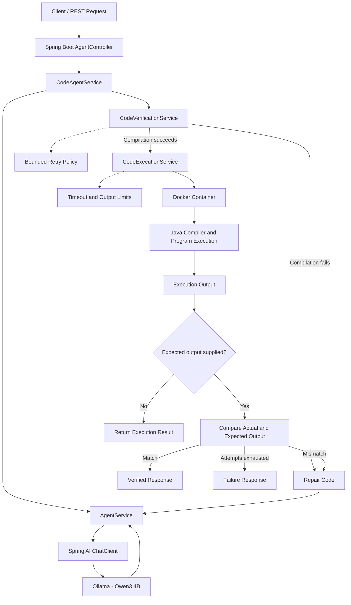

# AI Coding Agent — Architecture

## High-Level Architecture

## Main Components

- **AgentController:** Exposes REST endpoints and validates requests.
- **AgentService:** Generates Java code and requests AI-based repairs.
- **CodeAgentService:** Coordinates generation, compilation, execution, and retries.
- **CodeVerificationService:** Compiles generated Java source and captures compiler output.
- **CodeExecutionService:** Runs generated code in Docker with resource restrictions.
- **Ollama:** Runs the local Qwen3 4B language model.
- **Retry policy:** Limits repair attempts to prevent unbounded loops.

## Execution Flow

1. The client submits a coding task.
2. The local model generates Java code.
3. The verification service checks compilation.
4. If compilation fails, the agent requests a repair within the configured retry limit.
5. If compilation succeeds, the execution service runs the program in Docker.
6. For verified execution, the harness compares actual output with expected output.
7. The agent retries repairable failures within the configured limit and returns a structured response.

## Runtime Controls

- Container networking disabled.
- Memory limit: 256 MB.
- CPU limit: 0.5 CPU.
- Process-count limit: 32.
- Read-only container root filesystem.
- Non-root container user.
- Execution timeout: 20 seconds.
- Captured output limit: 64 KB.

These controls reduce risk but do not guarantee complete isolation from malicious code.
